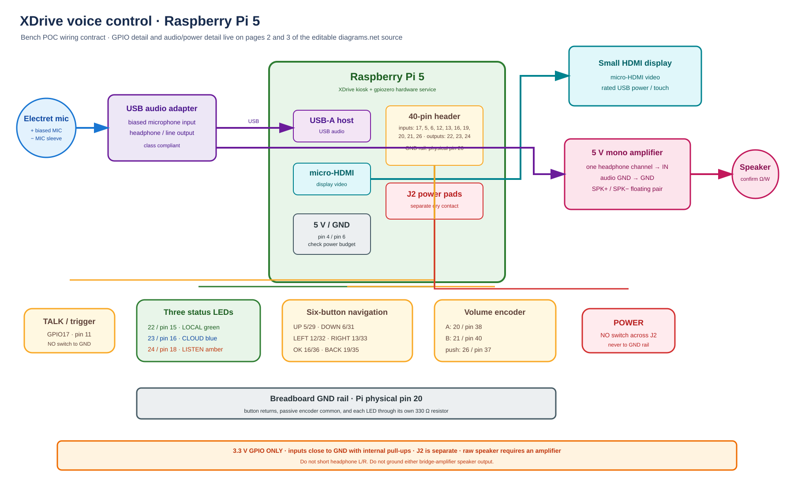

# XDrive voice breadboard

This is the Stage 2 voice, navigation, display, and three-indicator circuit for
the Pi 5 kiosk proof of concept. It keeps the power control on the Pi's
supported power-button input, uses the Pi I2S bus for full-duplex bench audio,
and keeps video on micro-HDMI.



The editable diagrams.net source now has three pages:

1. **System overview** — the complete Pi, controls, indicators, display, and
   audio signal path.
2. **GPIO breadboard** — the literal BCM/physical-pin wire map for the LEDs,
   active-low buttons, common ground rail, and passive rotary encoder.
3. **Audio, display & power** — INMP441 input, MAX98357A output, HDMI, J2, the
   bench BOM, and the staged bring-up gates.

## Signal path

```text
 INMP441 digital microphone ── I2S SD / GPIO20 ──► Raspberry Pi 5
          ▲                                           │
          └── shared BCLK GPIO18 + WS GPIO19 ─────────┤
                                                      ▼
 Raspberry Pi 5 ── I2S DIN / GPIO21 ──► MAX98357A ──► raw speaker

 Pi micro-HDMI ──► 5-inch display      Pi USB ──► display touch/power (as required)

 momentary TALK switch:  GPIO17 (physical pin 11) ── switch ── GND (pin 9)
 momentary POWER switch: Pi 5 J2 pad ─────────────── switch ── other J2 pad

 GPIO22 (physical pin 15) ── green LOCAL AI LED ── 330 Ω ── GND rail
 GPIO23 (physical pin 16) ── blue CLOUD AI LED ─── 330 Ω ── GND rail
 GPIO24 (physical pin 18) ── amber LISTENING LED ─ 330 Ω ── GND rail
 physical pin 20 / GND ───────────────────────────────────── GND rail

 GPIO5  / pin 29 ── UP switch ───── GND rail
 GPIO6  / pin 31 ── DOWN switch ─── GND rail
 GPIO12 / pin 32 ── LEFT switch ─── GND rail
 GPIO13 / pin 33 ── RIGHT switch ── GND rail
 GPIO16 / pin 36 ── OK switch ───── GND rail
 GPIO25 / pin 22 ── BACK switch ─── GND rail

 GPIO27 / pin 13 ── volume encoder A
 GPIO4  / pin 7  ── volume encoder B
 GPIO26 / pin 37 ── encoder push / MUTE
 encoder common and push return ──── GND rail

 GPIO18 / pin 12 ── I2S BCLK ── INMP441 SCK + MAX98357A BCLK
 GPIO19 / pin 35 ── I2S WS ──── INMP441 WS  + MAX98357A LRC
 GPIO20 / pin 38 ◄── INMP441 SD microphone data
 GPIO21 / pin 40 ──► MAX98357A DIN speaker data
```

## Wiring table

| Function | From | To | Notes |
| --- | --- | --- | --- |
| Push-to-talk | Pi header physical pin 11 / BCM GPIO17 | One side of a normally-open momentary switch | The kiosk enables an internal pull-up. Do not add 5 V or 3.3 V. |
| Push-to-talk return | Other side of the TALK switch | Pi header physical pin 9 / GND | A press pulls GPIO17 low. |
| Power | One Pi 5 J2 power-button pad | One side of a normally-open momentary switch | J2 is the two-pad power-button breakout near the RTC battery connector and board edge. |
| Power return | Other Pi 5 J2 pad | Other side of the POWER switch | Briefly close it. Do not put supply voltage on J2. |
| Local inference indicator | Pi physical pin 15 / BCM GPIO22 | Green LED anode; cathode through 330 Ω to the ground rail | Reserved for a future local inference runtime. It remains off in the cloud-only POC. |
| Cloud AI indicator | Pi physical pin 16 / BCM GPIO23 | Blue LED anode; cathode through 330 Ω to the ground rail | Steady while the Realtime cloud session is connected. |
| Listening indicator | Pi physical pin 18 / BCM GPIO24 | Amber LED anode; cathode through 330 Ω to the ground rail | Steady while the microphone is live. |
| Breadboard ground | Pi physical pin 20 / GND | Breadboard negative rail | Common return for LEDs, TALK, navigation, and encoder switches. |
| Navigation up | Pi physical pin 29 / BCM GPIO5 | Normally-open UP switch; other side to ground rail | Active-low with the Pi internal pull-up. |
| Navigation down | Pi physical pin 31 / BCM GPIO6 | Normally-open DOWN switch; other side to ground rail | Active-low with the Pi internal pull-up. |
| Navigation left | Pi physical pin 32 / BCM GPIO12 | Normally-open LEFT switch; other side to ground rail | Active-low with the Pi internal pull-up. |
| Navigation right | Pi physical pin 33 / BCM GPIO13 | Normally-open RIGHT switch; other side to ground rail | Active-low with the Pi internal pull-up. |
| Navigation OK | Pi physical pin 36 / BCM GPIO16 | Normally-open OK switch; other side to ground rail | Activates the focused kiosk control. |
| Navigation back | Pi physical pin 22 / BCM GPIO25 | Normally-open BACK switch; other side to ground rail | Returns Settings to XDrive; otherwise clears focus. |
| Volume encoder A | Pi physical pin 13 / BCM GPIO27 | Rotary encoder CLK/A | Use a mechanical encoder module compatible with 3.3 V logic. |
| Volume encoder B | Pi physical pin 7 / BCM GPIO4 | Rotary encoder DT/B | Clockwise and counter-clockwise steps change browser playback by 5%. |
| Volume mute | Pi physical pin 37 / BCM GPIO26 | Encoder push switch; other side to ground rail | Toggles mute and restores the previous audible level. |
| Display video | Pi micro-HDMI | Small HDMI display | The kiosk is the screen UI. This is deliberately not an SPI/GPIO display. |
| Display power/touch | Pi USB or a separate rated 5 V supply | Display USB input | Follow the display vendor's current requirement; do not power it from a GPIO signal pin. |
| I2S clock | Pi physical pin 12 / BCM GPIO18 | INMP441 SCK and MAX98357A BCLK | This clock net is shared by input and output but must remain separate from WS and both data nets. |
| I2S word select | Pi physical pin 35 / BCM GPIO19 | INMP441 WS and MAX98357A LRC | Shared frame clock. No button may use GPIO19 in Stage 2. |
| Microphone data | INMP441 SD | Pi physical pin 38 / BCM GPIO20 | Dedicated Pi input. INMP441 VDD goes to pin 1 / 3.3 V; GND and L/R go to pin 9 / GND for the left channel. |
| Speaker data | Pi physical pin 40 / BCM GPIO21 | MAX98357A DIN | Dedicated Pi output. Do not join this net to GPIO18, GPIO19, or GPIO20. |
| Amplifier power | Pi physical pin 2 / 5 V and pin 6 / GND | MAX98357A VIN and GND | Recheck the complete 5 V power budget before using the Pi header supply. |
| Speaker | MAX98357A SPK+ and SPK- | Two speaker leads | The raw speaker connects only across SPK+ and SPK-. Neither bridge output is ground. |

The photographed microphone appears to be a two-lead electret capsule. It
cannot connect directly to a Pi GPIO or to the INMP441 footprint. Stage 2 uses
an INMP441 breakout for the first digital loop. The photographed capsule can be
used later with a proper bias/preamp and audio ADC or a class-compliant USB
sound adapter. The rectangular part appears to be a raw two-wire speaker;
confirm its impedance and rating before driving it from the MAX98357A.

## Recommended first bench configuration

Use an INMP441 digital microphone breakout and a MAX98357A I2S amplifier on the
shared I2S clocks. The microphone data and speaker data remain separate on
GPIO20 and GPIO21. Connect the amplifier's `SPK+` and `SPK-` outputs only to
the two speaker leads; neither bridge-amplifier speaker output is ground.

Power the amplifier from a regulated 5 V source. Pi header physical pin 4 and
ground pin 6 are acceptable for the bench only after the Pi PSU, USB devices,
display, amplifier draw, and speaker load have been checked as one power
budget. A separate regulated 5 V supply is the safer fallback; join its ground
to Pi/audio ground for the amplifier input reference, while keeping both
speaker outputs isolated from ground.

The appliance software uses:

- BCM GPIO17, active-low, 30 ms debounce for push-to-talk;
- BCM GPIO22 / physical pin 15 for the green local-AI indicator;
- BCM GPIO23 / physical pin 16 for the blue cloud-AI indicator;
- BCM GPIO24 / physical pin 18 for the amber listening indicator;
- BCM GPIO5/6/12/13/16/25 for the physical up/down/left/right/OK/back array;
- BCM GPIO27/4 for the volume encoder and BCM GPIO26 for encoder push/mute;
- BCM GPIO18/19 for the shared I2S clocks, BCM GPIO20 for microphone data, and
  BCM GPIO21 for speaker data;
- the small screen over micro-HDMI, leaving the GPIO bus available and showing
  the same XDrive/Settings experience as the main kiosk;
- a three-LED chase while the Realtime response is thinking, then restoration
  of the steady connection/listening state;
- the Pi 5 J2 power header for safe shutdown and restart;
- the enrolled XDrive device credential for `/api/edge/realtime/calls`;
- the Azure-hosted `OPENAI_API_KEY` only inside `mxg-core`;
- manual Realtime turns: press enables the microphone and interrupts playback;
  release commits the input buffer and requests the response;
- authenticated cloud speech-to-text and text-to-speech through the same
  device-credential exchange used by the VR client, including partial user and
  assistant transcripts and synthesized-audio playback;
- 5% volume steps in Chromium, with mute/restore on encoder push.

## Bring-up order

1. Enroll the Pi from the kiosk's Equipment Pack card and confirm the node is
   shown as enrolled.
2. With power disconnected, wire the INMP441 and MAX98357A exactly as listed
   above. After boot, verify the configured I2S capture and playback devices
   with `arecord -l` and `aplay -l`.
3. Open the kiosk and select **Connect XDrive**. Hold the on-screen button for
   the first loop test.
4. Wire the TALK switch between physical pins 11 and 9. Confirm
   `systemctl status mxg-hardware-buttons.service` is healthy, then hold and
   release the physical switch.
5. With the Pi disconnected from power, wire the separate POWER switch across
   J2. Reconnect power and verify a brief press performs the normal Pi 5 power
   action. Avoid holding it, because a long hold is the hardware-forced shutdown
   path.

No provider API key, microphone recording, or transcript is written to the SD
image by this voice loop. The kiosk log records only state transitions and that
a transcript completed, not transcript text.
